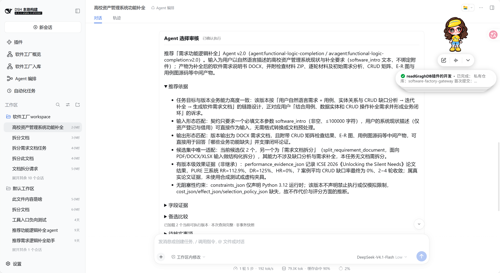

# 软件工厂 Agent 编排

运行在 DeepSeek Harness（DSH）中的 Agent 选择后端插件：理解用户任务、查询软件工厂数据库、推荐具体版本，经过聊天审核卡人工确认后，通过 Runtime 执行业务插件。

**普通用户请下载 [Releases](https://github.com/Waller-Man/software-factory-orchestration/releases) 中的预编译安装包，按下面的快速启动步骤安装。GitHub 的源码 ZIP 不等于插件安装包。** 本项目依附 DSH 运行，没有独立网站或自己的启动端口。

**必须接入并安装、启用配套的[软件工厂 WebUI](https://github.com/Waller-Man/software-factory-webui)，才能使用完整的编排界面。** 侧栏入口、审核卡和执行卡由 WebUI 提供，仅安装本后端不会显示这些界面。

当前插件版本为 `0.1.0`，包名为 `@software-factory/orchestration`。

## 功能

- **发现与推荐**：读取能力树、逻辑 Agent 和具体版本，比较业务适配性，给出推荐依据、字段证据和备选说明。
- **原生聊天与附件**：复用 DSH 聊天输入、文件上传及材料解析工具，支持继续引用当前会话以前上传的文件。
- **整理执行参数**：按真实业务接口补齐能确定的参数；缺少必需信息时在聊天中解释用途、提出建议并询问，不向用户展示业务参数表单。
- **人工审核与改选**：聊天卡片列出当前可执行版本，用户可改选 Agent，助手按新选择重新整理参数和报告。
- **独立执行模型**：使用 DSH 已配置的模型目录选择业务模型及推理强度；业务模型可以与主聊天模型不同。
- **确认并执行**：人工点击审核卡后启动任务，展示真实进度、错误、取消操作、最终交付下载和中间产物目录。

当前仅选择并执行**单个具体版本**，尚不提供多节点编排、拖动连线、自动格式转换或暂停恢复。数据库只读查询、选择审核和实际算法执行分别由 Gateway、本插件和 Runtime／业务插件负责。

## 运行截图

接入统一 WebUI 后，在原生聊天中展示 Agent 推荐、选择审核及推荐依据：



## 环境与配套插件

当前构建目标为 **DSH 0.2.1-alpha.2、Node.js 24 或以上**，Cordis peer 版本为 `4.0.5-alpha.1`。其他 DSH 版本需另外核对兼容性。

| 组件 | 用途及准备要求 |
| --- | --- |
| DSH 和模型配置 | 原生网页应可正常登录；在 DSH 设置中配置可用模型和聊天默认模型。 |
| HugeGraph 及软件工厂数据 | 准备已有能力树、Agent、版本和字段数据；本插件不自动建库、迁移或恢复数据库。 |
| Gateway | 包版本声明为 `^0.1.1`，提供能力树与候选查询；按其文档配置数据库连接。 |
| Runtime | 包版本声明为 `^0.1.0`，使用当前配套构建，管理真实业务入口、任务、模型和产物。 |
| 统一 WebUI | 提供“Agent 编排”侧栏、审核卡和执行卡，仅安装编排后端不会产生这些界面。 |
| 业务插件 | 至少一个通过 Run SDK 登记入口的插件，数据库中需有相应版本；Python、OCR 等依赖按业务插件说明提前准备。 |

统一 WebUI 还将 Gateway、Manage 声明为 peerDependencies，安装器可能校验这些依赖，按 WebUI README 准备。Manage 提供注册管理功能，不属于编排后端的数据库写入通道。

**本插件不需要 `.env` 或模型密钥。** HugeGraph 地址、认证和数据准备按照 Gateway 文档操作；模型和凭据由 DSH 管理。使用当前 Runtime 不需要手填 `allowedToolIds`。数据库版本标记为 `enabled`，不等于真实 Tool 已安装或运行环境已就绪。

## 新电脑快速启动：使用预编译包

### 1. 准备宿主和后端

1. 安装并启动兼容版本的 DSH，确认原生网页能够正常登录，并有“插件”管理入口。
2. 按 Gateway 文档准备数据库连接，安装并启用 Gateway，确认能读取真实软件工厂数据。
3. 安装并启用 Runtime、业务插件和统一 WebUI；WebUI 的其他安装依赖按其说明准备。业务入口应已接入 Run SDK，并与数据库记录的入口一致。
4. 在 DSH 配置可用模型，创建或打开真实工作区，确认当前会话具有工作区写入权限。

本 README 从 DSH 已正常运行开始说明；宿主安装和启动命令以对应 DSH 发行版文档为准。不需要为本插件另外启动前端服务或 Python 服务，业务插件自己的部署要求除外。

### 2. 下载并解压编排插件

从仓库的 [Releases／发布](https://github.com/Waller-Man/software-factory-orchestration/releases) 下载 `software-factory-orchestration-0.1.0.zip`，解压到长期保留的目录，例如：

```text
D:\DSH-Plugins\software-factory-orchestration\
├── package.json
├── cordis.patch.yml
├── README.md
├── THIRD_PARTY_NOTICES.md
├── icon.svg
├── docs\images\
├── lib\
├── skills\
└── locale\
```

以**包含 `package.json` 的目录**为准；多一层文件夹时继续进入内层。预编译包已含后端、模式、Skill 和 Remote 描述符，无需自行编译或在包内运行 `npm install`。DSH 安装器仍可能解析依赖，不承诺完全离线安装。

尚未发布 Release 时，请联系维护者获取预编译 ZIP 或完整运行目录。

### 3. 在 DSH 网页安装

1. 打开 **插件 → 添加插件 → 安装第三方插件**。
2. 安装来源填写上述目录的绝对路径，例如 `D:\DSH-Plugins\software-factory-orchestration`。这是 **DSH 服务端电脑**上的路径，浏览器电脑上的路径不能代替服务端路径；不要填写 ZIP 路径。
3. 安装后启用组合包及 `sf-orchestration`、`sf-orchestration-preset` 条目，确认没有激活错误。
4. 检查统一 WebUI 已启用，重启 DSH 并按 `Ctrl+F5` 强制刷新网页。
5. 侧栏应出现 **Agent 编排**，普通新聊天的模式菜单应出现同名选项；本包模式 ID 为 `sf-agent-orchestration`。

目录安装后请保留整个文件夹，不要删除、移动或改名。不要与旧同名编排模式混用，也不要重复启用独立 WebUI 与已经包含它的聚合 Bundle。

### 4. 验证可用（可视化验证需加载webui插件）

进入 **Agent 编排**，描述任务后能看到真实候选和“Agent 选择审核”卡；参数齐全后可选择模型并确认执行。安装检查无需运行耗时算法，实际执行需业务插件和模型均已就绪。

## 使用流程

1. 从侧栏进入 **Agent 编排**，或在新聊天中选择该模式，描述任务并按需上传附件。
2. 查看推荐及参数报告；缺少必需信息时在聊天中补充，不满意时在审核卡中改选 Agent。
3. 参数齐全后选择执行模型，点击 **确认并执行**。
4. 在任务卡查看进度、取消任务或下载最终交付；中间材料通过目录入口查看。

**必须选择编排模式，并通过审核卡确认执行。** 标准模式中只调用 Skill，或在聊天中说“同意”，不能代替这一步。执行材料保存在当前工作区的 `outputs/runs/<runId>/`，失败、取消后也会保留。

## 更新与停用

- **更新**：按发布说明替换安装文件，需要时同步更新 Gateway、Runtime、WebUI；重启 DSH 后强制刷新。
- **保留数据**：保留 DSH 插件存储与工作区 `outputs/`，升级不要求清空历史或迁移数据库 Schema。
- **停用／启用**：通过 DSH“插件”页操作。编排后端停用会释放其持有的会话，可能中断关联业务任务；停用前先确认任务状态。历史文件不会自动删除。
- **避免重复执行**：启动结果不明确时先检查已有任务，不通过重复点击确认来重试；旧审核失效时让助手重新提交。
- **保留安装目录**：本地目录安装后不要删除、移动或改名该目录。

## 遇到问题

- **没有入口或审核卡**：检查编排后端、模式条目和配套 WebUI 已启用，确认选择了编排模式，再重启并强制刷新。
- **没有候选、模型或执行按钮**：检查 Gateway、Runtime、业务入口和 DSH 模型配置，并补齐聊天中询问的必需信息。
- **执行、下载或目录打开异常**：检查任务日志、工作区权限和宿主文件打开能力；向维护者提供报错、插件版本和 `runId`，不要包含密钥。

## 源码与发布说明

本子仓库管理编排后端、Skill 和模式。前端源码在完整重构工程的 `packages/webui/src/pages/orchestration/`；当前构建与测试还依赖同级 Gateway、Runtime、contracts 和匹配 DSH 源码，单独克隆本子仓库并不能直接构建整个系统。

普通用户使用预编译安装包。源码与配置模板提交 Git，安装 ZIP 上传 **Releases 附件**；本地安装目录为 `artifacts/release/software-factory-orchestration/`，版本 ZIP 位于 `artifacts/`。`packages/` 用于源码模块，`artifacts/analysis/` 是构建暂存，均不能当作下载包目录交付。
